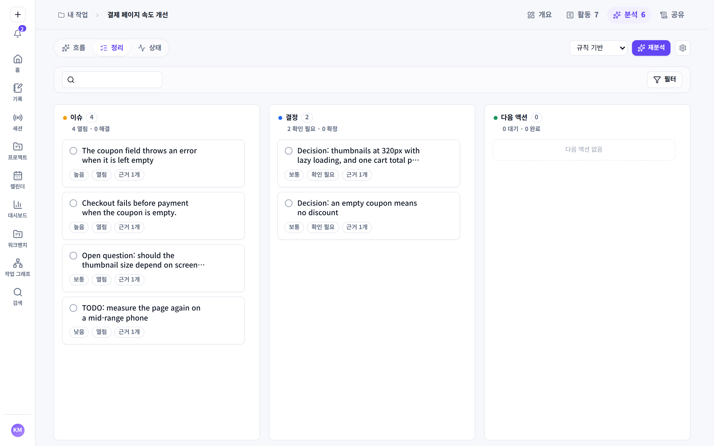
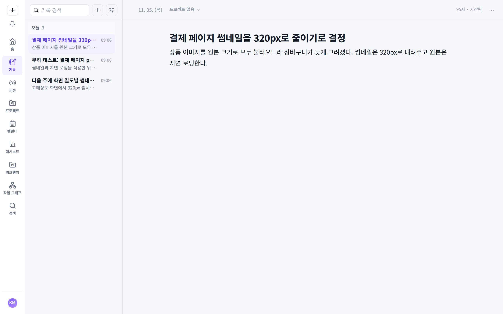

<div align="center">


# Mori

**A local-first personal context workspace.**

Mori turns the traces your work leaves behind into a connected record of what
you did, learned and decided, on your own machine.

[Features](#features) ·
[Platforms](#platforms) ·
[Build from source](#build-from-source) ·
[Documentation](#documentation)

[](LICENSE)

</div>

Work leaves traces everywhere: AI agent sessions, Git history, notes, pasted
conversations, links. Days later none of them answers *what did I actually do
that week*, *how did this project unfold*, or *what was decided and why*.

Mori collects those traces with as little ceremony as possible and keeps the
original of each one. It structures them into records anchored to the time they
happened and the projects they belong to, and keeps every automated change
visible and reversible.

Everything runs on your computer. Mori reads only the sources you connect,
keeps its data on your device, and sends nothing anywhere unless you grant a
provider yourself.






<sub>Shown with the built-in demo data and invented examples.</sub>

## Features

- **기록 (records).** A ledger of records with a timeline, a calendar and
  project grouping. Each record keeps a link to the source it came from.
- **Agent sessions.** Read-only discovery of local sessions from seven coding
  agents: Claude Code, Codex, OpenCode, Antigravity, Continue, Cline and
  Cursor. Active Claude Code sessions can be followed live as they run.
- **Imports.** Pasted AI transcripts, Git diffs from a repository you add
  explicitly, notes, URLs (stored, never fetched), and connector JSONL.
- **Analysis.** A deterministic rule-based engine by default. Ollama or any
  OpenAI-compatible endpoint can be added; a cloud provider is refused until
  you grant it.
- **Export.** A `.mori` package (zip) that round-trips your data, with a
  client-safe filter for handing work to someone else.

The complete feature inventory is in
[docs/mori-project-goal.md](docs/mori-project-goal.md).

## Platforms

Mori runs on **Windows 10 and 11 (x64)**. The per-user installer also
registers the native messaging host for the
[browser extension](https://github.com/hey-mori/mori-browser-extension) in
Chrome and Edge. The codebase builds and is tested on macOS and Linux as well.

## Privacy

These hold for every feature, current and planned:

- **Local-first.** No cloud sync by default, no account, no remote authority
  over your data.
- **No hidden capture.** No screen recording, keylogging, camera, or reading
  any source you did not connect.
- **Origins stay visible.** Every derived record keeps its source, and the
  original is kept so it can be derived again.

## Build from source

Prerequisites: Node.js 22, a stable Rust toolchain, and the
[Tauri v2 prerequisites](https://v2.tauri.app/start/prerequisites/) for your
platform.

```bash
npm ci
npm run dev          # the web UI in a browser, with the browser store
npm run tauri:dev    # the desktop app
npm run tauri:build  # the desktop bundle (an NSIS installer on Windows)
```

## Verify a change

```bash
scripts/setup-git-hooks.sh   # once per clone: commit message and push guards
scripts/check.sh             # the gate for the changed scope
scripts/check.sh --full      # everything, before opening a pull request
```

`scripts/check.sh` is the one definition of "verified", locally and in CI. Run
tests only through it or `npm test`; see
[docs/test-run-safety.md](docs/test-run-safety.md) for why, and
[docs/git-workflow.md](docs/git-workflow.md) for the branch, pull request and
merge rules.

## Tech stack

- **App:** React, TypeScript, Vite, Zustand
- **Desktop:** Tauri v2, Rust, SQLite through `rusqlite`
- **Styling:** layered CSS, see [docs/frontend-architecture.md](docs/frontend-architecture.md)
- **Tests:** Vitest and `cargo test`

## Documentation

- [Project goal](docs/mori-project-goal.md): identity, what is implemented,
  what is not
- [Context workspace architecture](docs/design/mori-context-workspace-architecture.md):
  the target design and decision order
- [Memory architecture](docs/memory-architecture.md): the implemented pipeline
- [Persistence](docs/persistence.md) and [SQLite migrations](docs/sqlite-migrations.md)
- [Imports](docs/imports.md) and the [`.mori` package](docs/mori-package-v0.md)
- [Desktop shell](docs/desktop-shell.md)
- [Git workflow](docs/git-workflow.md) and [commit format](docs/commit-format.md)

## Related projects

| Repository | What it is | Relationship to Mori |
| --- | --- | --- |
| [mori-lens](https://github.com/hey-mori/mori-lens) | A reading assistant: rest the pointer on text in any app and see it explained in your language | A separate product with its own binary. No shared code, database or runtime dependency |
| [mori-browser-extension](https://github.com/hey-mori/mori-browser-extension) | An opt-in Chromium extension that reports the active page | Sends page activity to Mori through Native Messaging; does nothing without Mori |
| [mori-web](https://github.com/hey-mori/mori-web) | The product website | Built from the same brand tokens |

## Contributing and security

Start with the organization's
[contributing guide](https://github.com/hey-mori/.github/blob/main/CONTRIBUTING.md),
which covers how a change lands and the sign-off (`git commit -s`) required on
commits from outside the organization. In this repository,
[docs/git-workflow.md](docs/git-workflow.md) and
[docs/commit-format.md](docs/commit-format.md) are the detailed rules, and
[CLAUDE.md](CLAUDE.md) adds what coding agents working here must follow.

Report vulnerabilities privately with this repository's
[report form](https://github.com/hey-mori/mori/security/advisories/new), never in
an issue. The organization's
[security policy](https://github.com/hey-mori/.github/blob/main/SECURITY.md)
covers what to include and what happens next.

## License

The source code in this repository is licensed under the [Mozilla Public License 2.0](LICENSE)
(`MPL-2.0`). Copyright 2026 Isaac Lee.

- Third-party dependencies keep their own licences.
- The licence grants no rights to the Mori names or logos as trademarks.
- Contributions are accepted under the same licence.

Claude Code, Codex, Cursor and the other tools named here are trademarks of
their owners. Mori is not affiliated with or endorsed by them.
