# Mori Product Screen Reference

These screenshots are product and UX references for Mori. They are not all implemented. They define the intended product direction, information architecture, layout patterns, and future implementation milestones.

## Status Legend

- **Implemented**: Current app behavior substantially matches the reference and is wired to real data.
- **Partial**: A screen or foundation exists, but the visible product does not fully match the reference.
- **Planned**: Product direction is defined, but the screen/behavior is not implemented yet.
- **Reference only**: Planning image or overview, not an app screen.

## Screen Index

| Screen | Status | Reference | Prompt/spec |
| --- | --- | --- | --- |
| [Start Session / Session Setup](#start-session-session-setup) | Partial | [start-session-reference.png](assets/screenshots/start-session-reference.png) | [product-screen-prompts.md](product-screen-prompts.md) |
| [Evidence Hub](#evidence-hub) | Partial | [evidence-hub-reference.png](assets/screenshots/evidence-hub-reference.png) | [product-screen-prompts.md#1-evidence-hub](product-screen-prompts.md#1-evidence-hub) |
| [AI Transcript Import](#ai-transcript-import) | Partial | [ai-transcript-import-reference.png](assets/screenshots/ai-transcript-import-reference.png) | [product-screen-prompts.md#2-ai-transcript-import](product-screen-prompts.md#2-ai-transcript-import) |
| [Git Diff Import](#git-diff-import) | Partial | [git-diff-import-reference.png](assets/screenshots/git-diff-import-reference.png) | [product-screen-prompts.md#3-git-diff-import](product-screen-prompts.md#3-git-diff-import) |
| [Import Review / Evidence Mapping](#import-review-evidence-mapping) | Planned | [import-review-evidence-mapping-reference.png](assets/screenshots/import-review-evidence-mapping-reference.png) | [product-screen-prompts.md#4-import-review--evidence-mapping](product-screen-prompts.md#4-import-review--evidence-mapping) |
| [Narrative Timeline](#narrative-timeline) | Partial | [narrative-timeline-reference.png](assets/screenshots/narrative-timeline-reference.png) | [product-screen-prompts.md#5-narrative-timeline](product-screen-prompts.md#5-narrative-timeline) |
| [Flow Focus / Trace View](#flow-focus-trace-view) | Partial | [flow-focus-trace-view-reference.png](assets/screenshots/flow-focus-trace-view-reference.png) | [product-screen-prompts.md#6-flow-focus--trace-view](product-screen-prompts.md#6-flow-focus--trace-view) |
| [Review](#review) | Partial | [review-reference.png](assets/screenshots/review-reference.png) | [product-screen-prompts.md#7-review](product-screen-prompts.md#7-review) |
| [Resume & Reports](#resume-reports) | Partial | [resume-reports-reference.png](assets/screenshots/resume-reports-reference.png) | [product-screen-prompts.md#8-resume--reports](product-screen-prompts.md#8-resume--reports) |
| [End Session / Session Summary](#end-session-session-summary) | Planned | [end-session-summary-reference.png](assets/screenshots/end-session-summary-reference.png) | [product-screen-prompts.md#9-end-session--session-summary](product-screen-prompts.md#9-end-session--session-summary) |
| [Project Memory](#project-memory) | Partial | [project-memory-reference.png](assets/screenshots/project-memory-reference.png) | [product-screen-prompts.md#10-project-memory](product-screen-prompts.md#10-project-memory) |
| [Settings / Privacy / Local AI](#settings-privacy-local-ai) | Partial | [settings-privacy-local-ai-reference.png](assets/screenshots/settings-privacy-local-ai-reference.png) | [product-screen-prompts.md#11-settings--privacy--local-ai](product-screen-prompts.md#11-settings--privacy--local-ai) |
| [Connector Setup](#connector-setup) | Planned | [connector-setup-reference.png](assets/screenshots/connector-setup-reference.png) | [product-screen-prompts.md#12-connector-setup](product-screen-prompts.md#12-connector-setup) |
| [Edit Event / Correction Panel](#edit-event-correction-panel) | Planned | [edit-event-correction-panel-reference.png](assets/screenshots/edit-event-correction-panel-reference.png) | [product-screen-prompts.md#13-edit-event--correction-panel](product-screen-prompts.md#13-edit-event--correction-panel) |
| [Product Overview / Screen Map](#product-overview-screen-map) | Reference only | [product-overview-screen-map-reference.png](assets/screenshots/product-overview-screen-map-reference.png) | [product-screen-prompts.md#14-product-overview--screen-map](product-screen-prompts.md#14-product-overview--screen-map) |

## Reference Screens

### Start Session / Session Setup

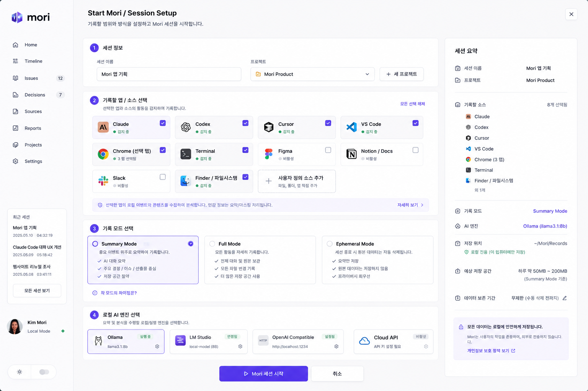

- **Status:** Partial
- **Product purpose:** Define a deliberate recording boundary before any work memory exists.
- **Primary user job:** Start a scoped Mori session with clear sources, mode, project, local AI, and storage expectations.
- **Key UI elements:** Session name, project picker, source choices, recording mode cards, local AI engine choices, privacy/storage summary.
- **Main actions:** Start Mori, cancel, choose sources/mode/engine, review session summary.
- **Data shown:** Project, selected source types, recording mode, AI engine, save location, estimated storage.
- **Source/provenance expectations:** All future evidence must come from selected or explicitly imported sources.
- **Privacy expectations:** User-controlled session start; no ambient recording.
- **Persistence expectations:** Session metadata should be saved locally and later to SQLite/.mori.
- **Implementation notes:** Existing app has a Start Session surface; keep status Partial until it fully matches the reference.
- **Prompt/spec source:** [product-screen-prompts.md](product-screen-prompts.md)

### Evidence Hub

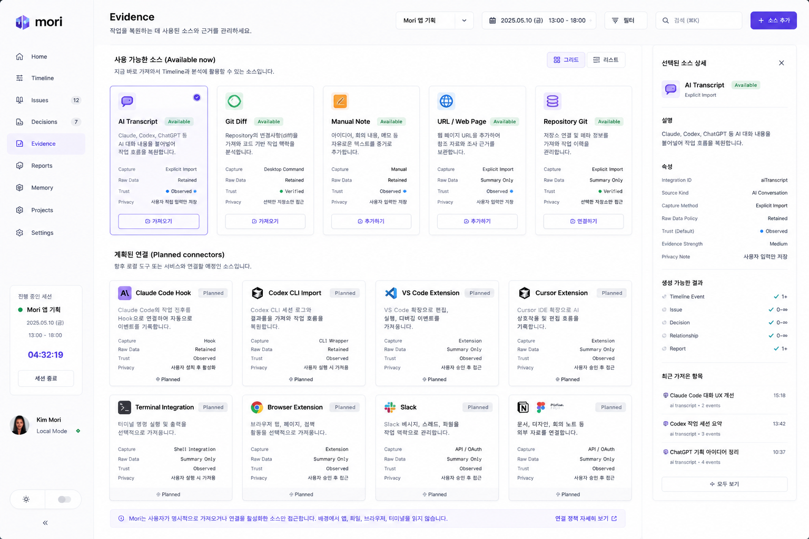

- **Status:** Partial
- **Product purpose:** Central source/evidence management for Mori.
- **Primary user job:** Add, inspect, and understand the evidence Mori can use to reconstruct work.
- **Key UI elements:** Available source cards, planned connector cards, selected source inspector, provenance details, add source action.
- **Main actions:** Add/import source, inspect source detail, distinguish available from planned connectors.
- **Data shown:** Source kind, capture method, raw policy, trust level, privacy note, provenance, recent imports.
- **Source/provenance expectations:** Evidence cards must expose provenance and capture method.
- **Privacy expectations:** Explicit import only; planned connectors are opt-in and not silently active.
- **Persistence expectations:** Imported SourceRef records persist with raw retention policy.
- **Implementation notes:** Current Evidence view exists, but this richer hub is only partial.
- **Prompt/spec source:** [product-screen-prompts.md#1-evidence-hub](product-screen-prompts.md#1-evidence-hub)

### AI Transcript Import

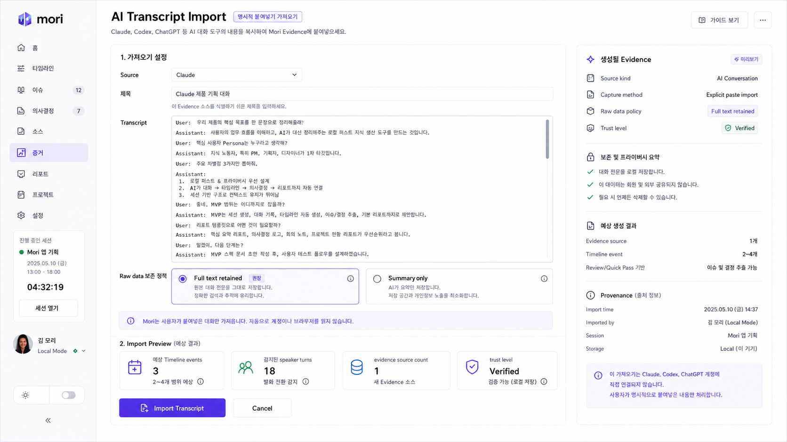

- **Status:** Partial
- **Product purpose:** Paste AI chat transcripts into Mori as evidence.
- **Primary user job:** Bring Claude/Codex/ChatGPT/Other AI conversations into a session without account access.
- **Key UI elements:** Source selector, title input, transcript textarea, raw policy selector, import preview, generated evidence panel.
- **Main actions:** Paste transcript, choose retention, preview, import, cancel.
- **Data shown:** Speaker turns, source count, expected event count, trust level, provenance.
- **Source/provenance expectations:** Transcript source is user-provided text only.
- **Privacy expectations:** No Claude/Codex/ChatGPT account scraping, OAuth, API-key access, or browser scanning.
- **Persistence expectations:** Store summary/metadata unless user explicitly chooses full retention.
- **Implementation notes:** Import normalizers exist; dedicated reference screen remains partial.
- **Prompt/spec source:** [product-screen-prompts.md#2-ai-transcript-import](product-screen-prompts.md#2-ai-transcript-import)

### Git Diff Import

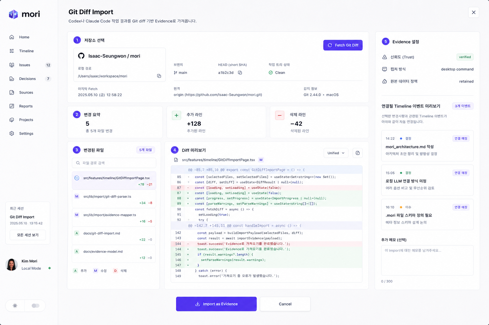

- **Status:** Partial
- **Product purpose:** Import code-change evidence from a selected Git diff.
- **Primary user job:** Turn an explicit repo/range diff into verified file/code evidence.
- **Key UI elements:** Repository card, branch/SHA/dirty status, fetch action, changed file list, diff preview, evidence settings panel.
- **Main actions:** Fetch Git Diff, review changed files, import as evidence, cancel.
- **Data shown:** Repo path, branch, HEAD SHA, dirty state, changed files, additions/deletions, linked event preview.
- **Source/provenance expectations:** Git diff is verified evidence from a selected repo/range.
- **Privacy expectations:** No repo scanning, no file watcher, no automatic fetch.
- **Persistence expectations:** Persist imported diff evidence and repository metadata separately.
- **Implementation notes:** Pasted and Tauri git diff foundations exist; reference screen is partial.
- **Prompt/spec source:** [product-screen-prompts.md#3-git-diff-import](product-screen-prompts.md#3-git-diff-import)

### Import Review / Evidence Mapping

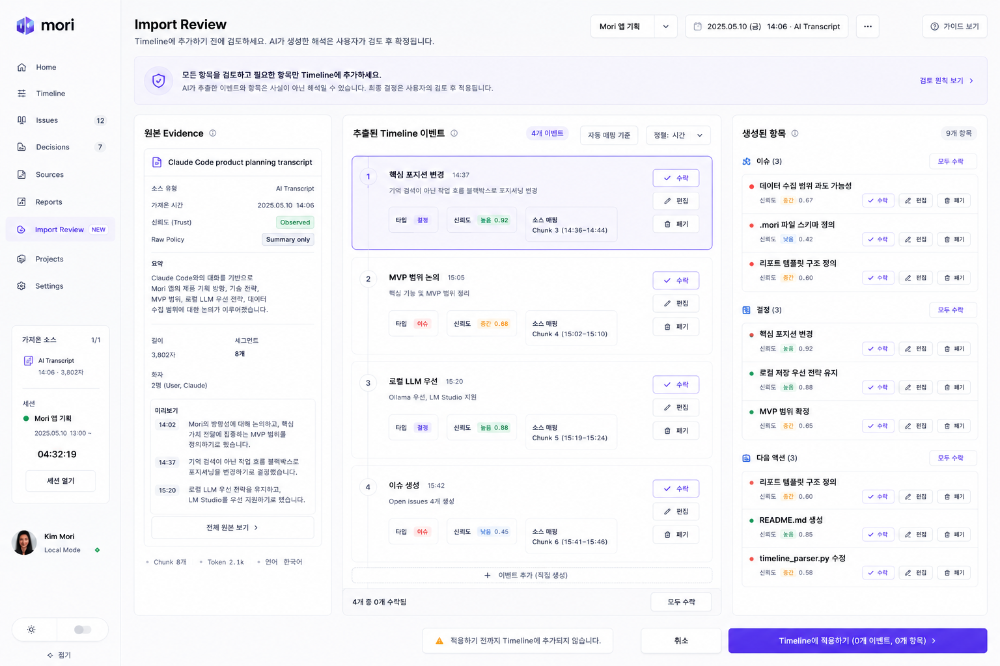

- **Status:** Planned
- **Product purpose:** Review extracted events/items before applying them to the timeline.
- **Primary user job:** Accept, edit, or discard AI interpretations produced from an import.
- **Key UI elements:** Original evidence card, extracted timeline event list, generated Issues/Decisions/Next Actions, review banner, apply bar.
- **Main actions:** Accept, edit, discard, add manual event, apply to timeline.
- **Data shown:** Candidate events, confidence, source mapping, generated items, review state.
- **Source/provenance expectations:** Every candidate item must point back to its source chunk/evidence.
- **Privacy expectations:** AI output remains provisional until user review.
- **Persistence expectations:** Only accepted/edited items become durable timeline/review records.
- **Implementation notes:** Do not silently apply AI-generated interpretations.
- **Prompt/spec source:** [product-screen-prompts.md#4-import-review--evidence-mapping](product-screen-prompts.md#4-import-review--evidence-mapping)

### Narrative Timeline

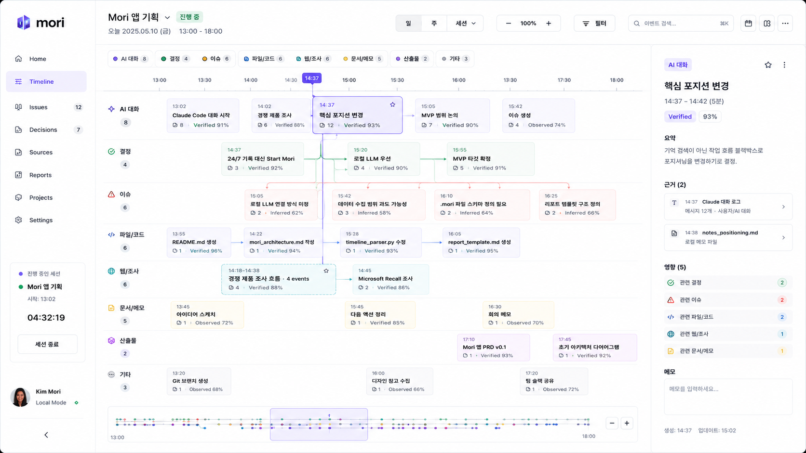

- **Status:** Partial
- **Product purpose:** Primary chronological reconstruction of how work happened.
- **Primary user job:** Scan a session as structured lanes, inspect evidence, and understand major work moments.
- **Key UI elements:** Sidebar, session header, toolbar, category chips, time ruler, lane grid, cards/bundles, inspector, minimap.
- **Main actions:** Search/filter, select event/bundle, open Flow Focus, inspect evidence, adjust view.
- **Data shown:** Events, bundles, trust/confidence, evidence counts, related issues/decisions, source links.
- **Source/provenance expectations:** Cards and bundles must remain evidence-backed and inspectable.
- **Privacy expectations:** Timeline should show provenance rather than implying omniscient capture.
- **Persistence expectations:** Timeline items come from stored sources/events/analysis results.
- **Implementation notes:** Reference alignment remains ongoing; Timeline is partial, not done because tests pass.
- **Prompt/spec source:** [product-screen-prompts.md#5-narrative-timeline](product-screen-prompts.md#5-narrative-timeline)

### Flow Focus / Trace View

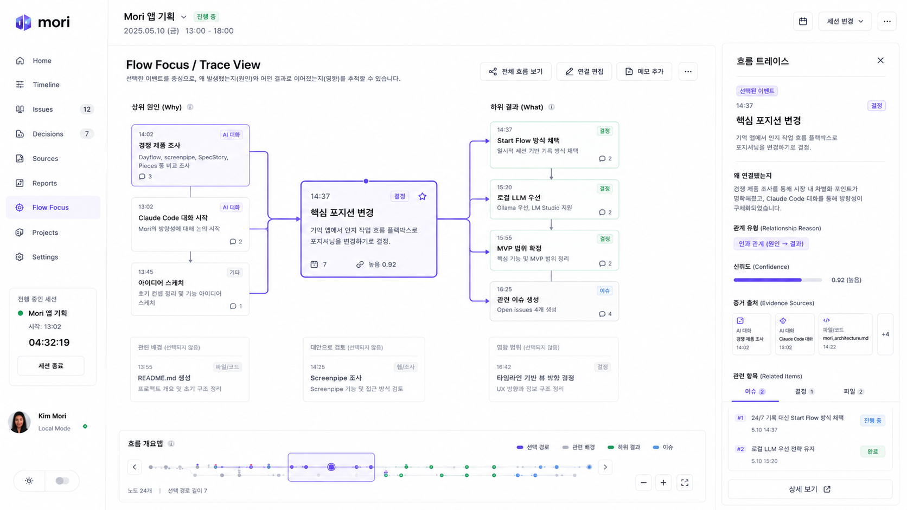

- **Status:** Partial
- **Product purpose:** Explain causes and outcomes around one selected event.
- **Primary user job:** Understand why a decision/issue/event happened and what it affected.
- **Key UI elements:** Focused central event, upstream causes, downstream results, relationship lines, trace inspector, minimap.
- **Main actions:** View full flow, edit connection, add memo, inspect related sources/items.
- **Data shown:** Relationship reason, confidence, evidence sources, related issues/decisions/files.
- **Source/provenance expectations:** Relationship explanations must be traceable to source evidence or inference.
- **Privacy expectations:** No hidden graph exploration from background capture.
- **Persistence expectations:** Relationships and corrections should persist once editing is implemented.
- **Implementation notes:** Current Flow Focus exists but reference-grade trace panel remains partial.
- **Prompt/spec source:** [product-screen-prompts.md#6-flow-focus--trace-view](product-screen-prompts.md#6-flow-focus--trace-view)

### Review

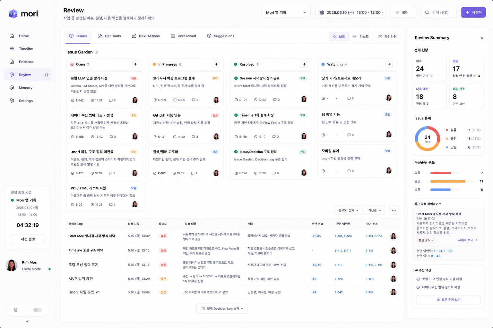

- **Status:** Partial
- **Product purpose:** Review issues, decisions, next actions, unresolved items, and suggestions.
- **Primary user job:** Turn reconstructed work into actionable review records without becoming a task manager.
- **Key UI elements:** Tabs, Issue Garden board, Decision Log table, right Review Summary, statistics, suggestions.
- **Main actions:** Filter, inspect issue/decision, add item, switch board/list/timeline views.
- **Data shown:** Issues, decisions, next actions, priorities, statuses, evidence links, related events.
- **Source/provenance expectations:** Every issue/decision should link to evidence or source events.
- **Privacy expectations:** AI suggestions should be marked as suggestions until accepted.
- **Persistence expectations:** Accepted review records persist to session/project memory.
- **Implementation notes:** Existing Review page is partial and should be refined against this reference.
- **Prompt/spec source:** [product-screen-prompts.md#7-review](product-screen-prompts.md#7-review)

### Resume & Reports

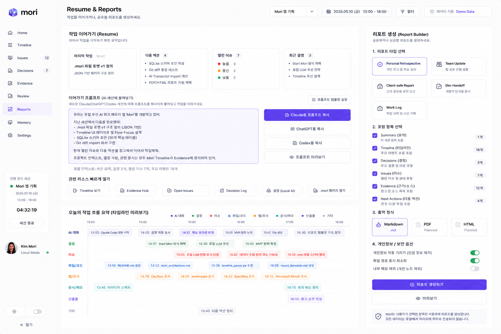

- **Status:** Partial
- **Product purpose:** Continue work or generate privacy-aware reports.
- **Primary user job:** Copy a resume prompt or produce a shareable report from the session.
- **Key UI elements:** Resume summary cards, prompt textarea, copy buttons, resource links, timeline preview, Report Builder.
- **Main actions:** Copy prompt, preview prompt, choose report type/sections/format, generate report.
- **Data shown:** Last work, next actions, open issues, decisions, timeline highlights, included evidence.
- **Source/provenance expectations:** Resume/report content should cite Timeline and Evidence context.
- **Privacy expectations:** Redaction and output format availability must be explicit.
- **Persistence expectations:** Generated reports should be saved once report export is implemented.
- **Implementation notes:** Current Reports page is partial; PDF/HTML remain planned unless implemented.
- **Prompt/spec source:** [product-screen-prompts.md#8-resume--reports](product-screen-prompts.md#8-resume--reports)

### End Session / Session Summary

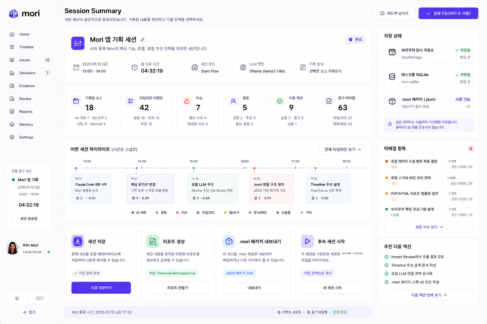

- **Status:** Planned
- **Product purpose:** Close a Mori session with saved state, highlights, and next options.
- **Primary user job:** Confirm what was captured, where it was saved, and what to do next.
- **Key UI elements:** Session summary, metric cards, save status, highlight timeline, unresolved items, recommended actions, closing action cards.
- **Main actions:** Save session, generate report, export .mori, start follow-up session, return to dashboard.
- **Data shown:** Duration, sources, events, issues, decisions, next actions, evidence count, storage status.
- **Source/provenance expectations:** Summary must be generated from accepted session records.
- **Privacy expectations:** Local storage status and cloud non-use must be explicit.
- **Persistence expectations:** Browser draft, Desktop SQLite, and .mori package states must be honest.
- **Implementation notes:** Planned; do not wire fake end-session behavior.
- **Prompt/spec source:** [product-screen-prompts.md#9-end-session--session-summary](product-screen-prompts.md#9-end-session--session-summary)

### Project Memory

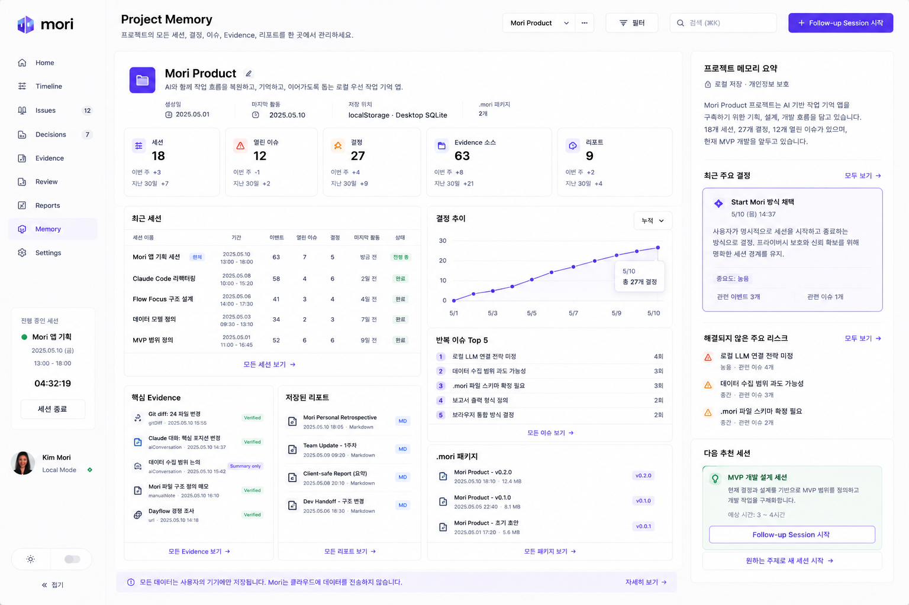

- **Status:** Partial
- **Product purpose:** Long-term memory across sessions in one project.
- **Primary user job:** See accumulated decisions, issues, evidence, reports, and suggested follow-up sessions.
- **Key UI elements:** Project profile, stats, recent sessions, decision trend, recurring issues, key evidence, reports, package list, right summary.
- **Main actions:** Open session, view evidence/report/package, start follow-up session.
- **Data shown:** Sessions, decisions, issues, evidence sources, reports, packages, trends.
- **Source/provenance expectations:** Cross-session summaries must reference the sessions/evidence they use.
- **Privacy expectations:** Project memory is from selected sessions, not background monitoring.
- **Persistence expectations:** Requires durable project/session storage and .mori package history.
- **Implementation notes:** Current Memory view exists but reference depth is partial.
- **Prompt/spec source:** [product-screen-prompts.md#10-project-memory](product-screen-prompts.md#10-project-memory)

### Settings / Privacy / Local AI

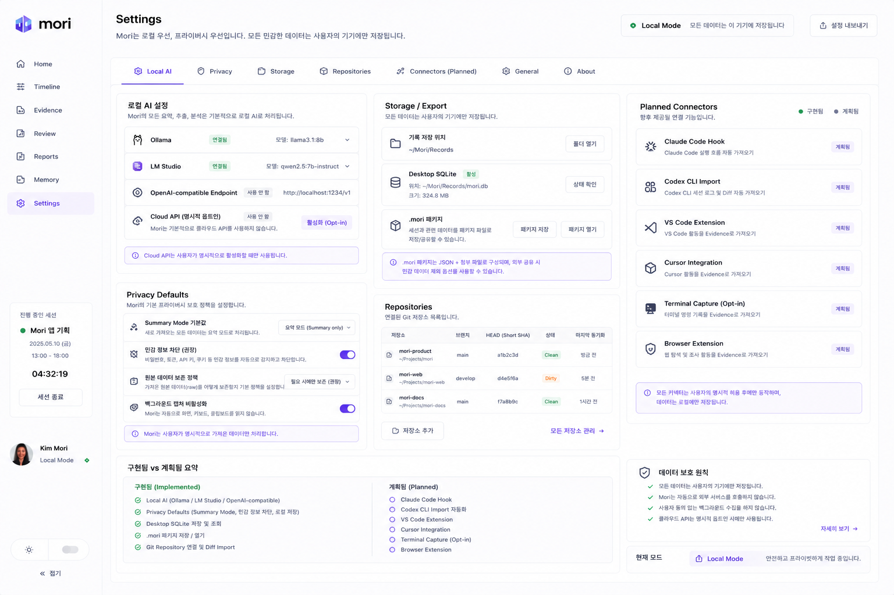

- **Status:** Partial
- **Product purpose:** Configure local AI, privacy defaults, storage/export, repositories, and connector plans.
- **Primary user job:** Understand and control what Mori stores, how it analyzes, and which integrations are planned.
- **Key UI elements:** Local AI, Privacy Defaults, Storage/Export, Repositories, Planned Connectors, implemented/planned summary.
- **Main actions:** Configure providers, set privacy defaults, verify repositories, manage storage, review planned connectors.
- **Data shown:** Provider status, storage path, SQLite status, repository branch/SHA/dirty state, connector status.
- **Source/provenance expectations:** Settings should explain source access boundaries.
- **Privacy expectations:** Local-first default; Cloud API explicit opt-in; no background capture by default.
- **Persistence expectations:** Settings should persist locally and in desktop storage when available.
- **Implementation notes:** Existing Settings page is partial; connector setup remains planned.
- **Prompt/spec source:** [product-screen-prompts.md#11-settings--privacy--local-ai](product-screen-prompts.md#11-settings--privacy--local-ai)

### Connector Setup

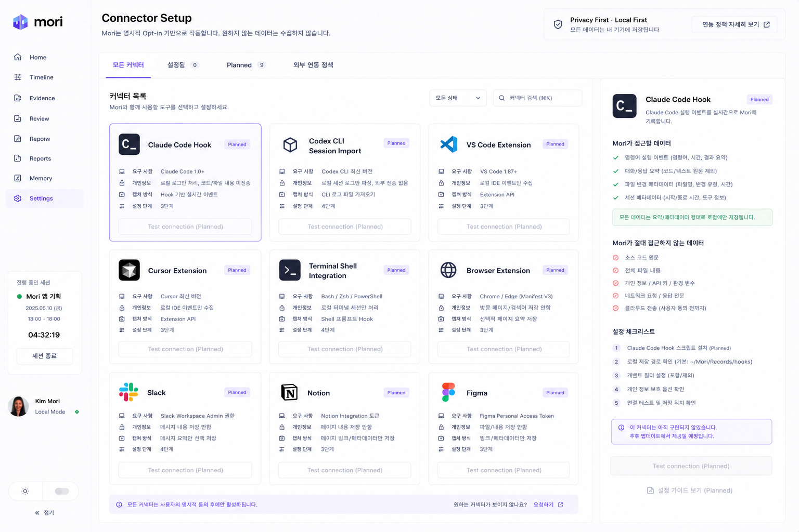

- **Status:** Planned
- **Product purpose:** Future opt-in connector setup and policy screen.
- **Primary user job:** Choose and configure integrations only when the user explicitly wants them.
- **Key UI elements:** Connector grid, selected connector detail, access policy, never-access list, setup checklist, disabled test buttons.
- **Main actions:** Select connector, review policy, follow setup steps, test connection when implemented.
- **Data shown:** Connector status, requirements, capture method, privacy notes, setup steps.
- **Source/provenance expectations:** Connector evidence must be scoped to user-approved integration settings.
- **Privacy expectations:** No connector should appear connected unless it really is; all access is opt-in.
- **Persistence expectations:** Connector settings should persist only after implementation.
- **Implementation notes:** Reference/planned. Do not imply current connector functionality.
- **Prompt/spec source:** [product-screen-prompts.md#12-connector-setup](product-screen-prompts.md#12-connector-setup)

### Edit Event / Correction Panel

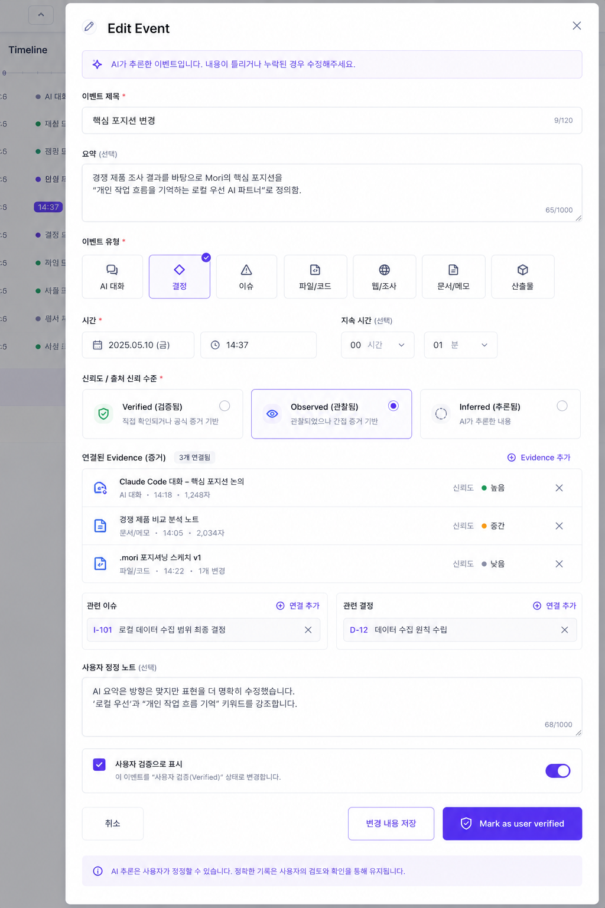

- **Status:** Planned
- **Product purpose:** Correct AI-inferred Timeline events.
- **Primary user job:** Edit event meaning, time, type, trust, evidence, and related records.
- **Key UI elements:** Modal/panel with title, summary, type selector, time controls, trust selector, evidence links, related issue/decision links, correction note.
- **Main actions:** Save changes, cancel, mark as user verified, add/remove evidence/links.
- **Data shown:** Event fields, trust level, source evidence, related issues/decisions, user correction note.
- **Source/provenance expectations:** Corrections should preserve original AI inference and user override provenance.
- **Privacy expectations:** User verification is explicit and should not mutate evidence silently.
- **Persistence expectations:** Requires correction persistence before shipping active controls.
- **Implementation notes:** Planned; current inspector should keep correction controls disabled/planned.
- **Prompt/spec source:** [product-screen-prompts.md#13-edit-event--correction-panel](product-screen-prompts.md#13-edit-event--correction-panel)

### Product Overview / Screen Map

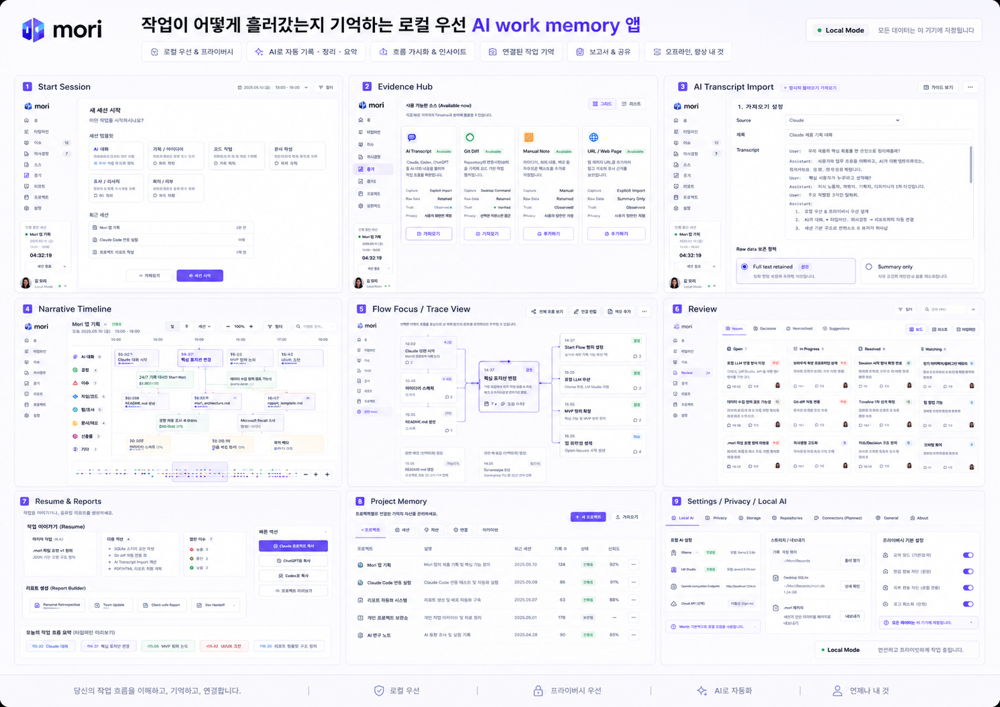

- **Status:** Reference only
- **Product purpose:** Single reference image showing Mori as a coherent product system.
- **Primary user job:** Orient future implementation tasks around the full app surface map.
- **Key UI elements:** Thumbnail map of major screens and product promise.
- **Main actions:** None; planning material only.
- **Data shown:** Screen names and system-level product flow.
- **Source/provenance expectations:** Not an app data surface.
- **Privacy expectations:** Reinforces local-first posture and user-controlled import.
- **Persistence expectations:** None.
- **Implementation notes:** Reference only. Do not treat overview thumbnails as implemented screens.
- **Prompt/spec source:** [product-screen-prompts.md#14-product-overview--screen-map](product-screen-prompts.md#14-product-overview--screen-map)

## Older Normalized References

The repository also keeps earlier reference images that remain useful for visual comparison:

- [Timeline Main earlier reference](assets/screenshots/timeline-main-reference.png)
- [Flow Focus earlier reference](assets/screenshots/flow-focus-reference.png)
- [Review / Issues & Decisions earlier reference](assets/screenshots/review-issues-decisions-reference.png)
- [Resume Report earlier reference](assets/screenshots/resume-report-reference.png)
- [Start Session reference](assets/screenshots/start-session-reference.png)

Use the screen-specific reference sections above as the planning source of truth, and use older references only for historical comparison unless a future task explicitly chooses them.

