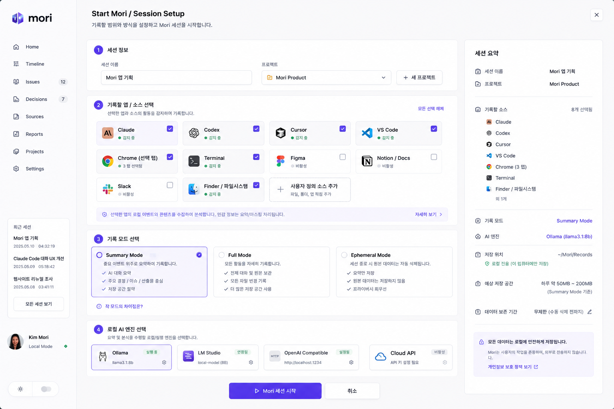
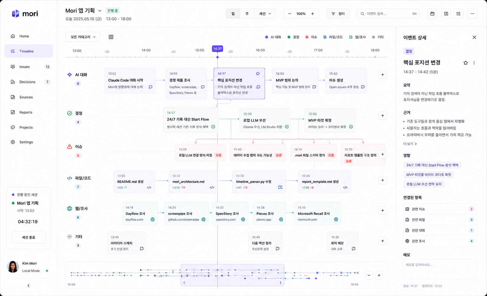
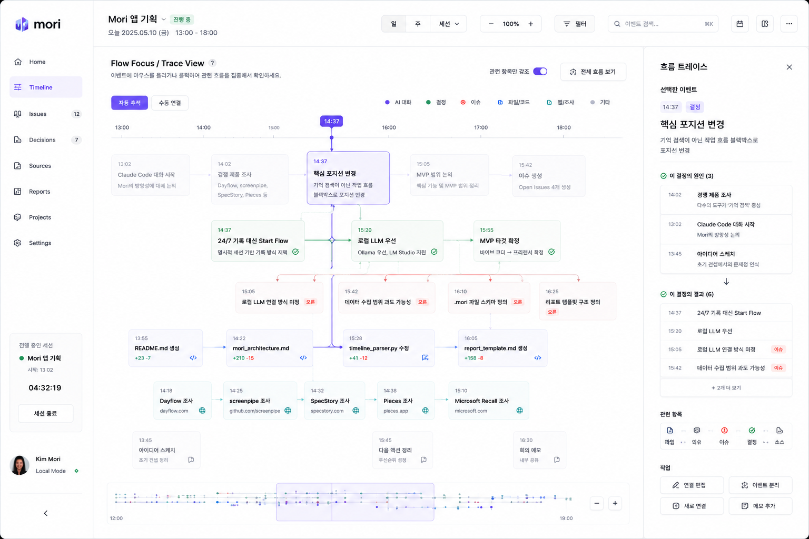
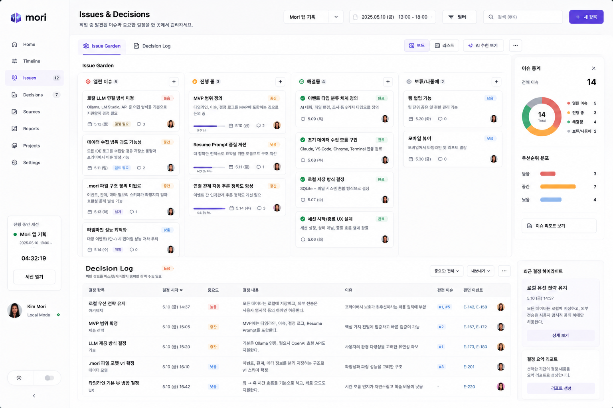
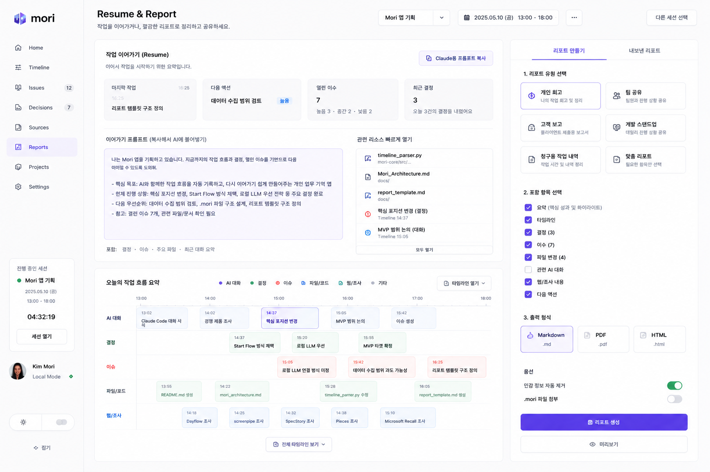

# UX Reference

This document captures the visual direction and product intent behind the current Mori UI references.

## Visual Direction

Mori should feel like a formal productivity app: calm, dense, professional, local-first, and privacy-aware. The visual language sits near Linear, Figma, Notion, and Apple productivity software rather than a marketing site or decorative dashboard.

Core visual traits:

- formal productivity UI
- calm white/soft-gray surfaces
- purple accent for active state and Mori identity
- lane-based timeline
- right inspector panel
- left navigation sidebar
- dense but readable work-memory UI
- visible local-first and privacy controls
- evidence-oriented interaction model

## Start Mori / Session Setup

The Start Mori screen defines the recording boundary before any work memory is created.

It should make these choices explicit:

- session name
- project selection
- source selection
- recording mode selection
- local AI engine selection
- local-first privacy summary

The right summary panel reinforces what will be recorded, where it will be stored, and which local AI engine will be used. This is the trust-building moment before a session begins.

## Timeline Main View

The Timeline Main View is Mori's primary work-memory screen.

Key elements:

- left sidebar
- top session header
- horizontal time axis
- single-row-first timeline lanes
- event cards for major moments
- work-flow bundles for dense periods
- right event detail panel
- bottom mini map

The horizontal lane structure lets users scan how work moved across AI conversation, decisions, issues, file/code changes, web research, and notes. The right inspector keeps evidence, impact, related items, and notes close to the selected event.

Dense periods should not collapse into a generic `+N more` chip. Mori's
job is to explain how work unfolded, so crowded moments need intentional
bundle cards such as:

- research burst
- decision flow
- issue burst
- code change burst
- AI-to-decision sequence

Each bundle should still communicate time range, dominant meaning, included
types, evidence/trust, and what it represents in the work flow.

Current implementation notes:

- The Timeline operates on display items: raw events or workflow bundles.
- Same-lane dense moments can be bundled while selected and important
  decision events remain individual cards.
- Relationship lines are hidden in the default Timeline and reserved for Flow
  Focus, where relationship inspection is the primary task.
- Lane cards keep to time, title, evidence/trust, and compact metadata. Longer
  summaries and bundle reasoning move to the right inspector so the grid stays
  aligned and readable.
- The bottom overview rail is an orientation surface with event dots, a
  viewport highlight, and a selected marker; direct minimap navigation remains
  planned.
- At narrower desktop widths Mori keeps the sidebar and inspector stable and
  lets the lane frame scroll horizontally instead of compressing cards until
  they become unreadable.

## Flow Focus / Trace View

Flow Focus is Mori's signature interaction. It reduces timeline complexity by highlighting only the work flow related to a selected event.

Key elements:

- selected event
- dimmed unrelated events
- highlighted related flow
- trace panel
- causes and results
- relationship editing actions

The trace panel should make the AI-generated structure inspectable. Users need to understand why Mori thinks one event caused, supported, influenced, or produced another.

## Review (Issues & Decisions)

Issues & Decisions (now consolidated in the Review page) turns the session into actionable product memory.

Key elements:

- Issue Garden board
- issue statuses
- priority distribution
- Decision Log
- recent decision highlight

Issue Garden should separate open, in-progress, resolved, and watching items. Decision Log should capture important choices with rationale, related issues, source events, and evidence.

## Reports (Resume & Report)

Resume & Report (now consolidated in the Reports page) helps users continue the work or communicate what happened.

Key elements:

- resume prompt
- next actions
- related resources
- report type selection
- include toggles
- output formats
- privacy options

Resume Prompt should be immediately useful in a new AI session. Reports should be shareable but controlled, with privacy and inclusion choices visible before export.

## UX Principles

- Timeline first, graph second
- Single-row lanes first, unlimited stacking never as the default
- Dense moments become work-flow bundles, not generic hidden clusters
- Evidence must be inspectable
- AI output must be correctable
- Local-first trust must be visible
- Flow Focus should reduce complexity
- Reports should be shareable but privacy-safe
